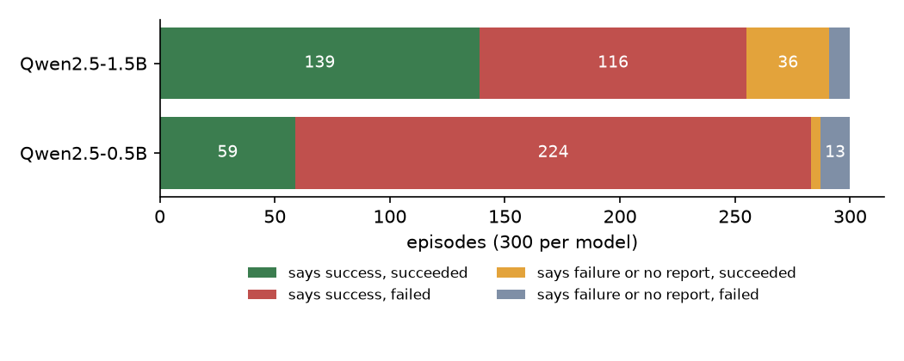
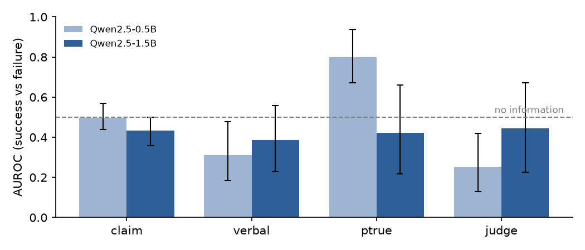

# webverify  can you trust a small web agent when it says "done"?

A web agent ends every task with a report: *success* or *failure*. If nobody re-checks a reported
success, a false one is never caught. This project measures how often small local language-model
agents claim false successes, and whether cheap signals (the agent's own confidence, its token
probabilities, an independent judge) can tell a reviewer which claims to check.

Everything runs locally: 15 tasks from the public **MiniWoB++** benchmark in headless Chromium, and
two open-weight models (**Qwen2.5-Instruct 0.5B and 1.5B**, 4-bit GGUF, llama.cpp on CPU, greedy
decoding). The ground truth is the benchmark page's own reward, which the agent never sees. No paid or
external API is used.

The protocol ([docs/TASK.md](docs/TASK.md)) was written before the main run, and the pilot that
changed the prompts used separate seeds that are not part of any result. Every number below comes
from [docs/results.md](docs/results.md), which `scripts/analyse.py` generates from the episode logs.

## Main findings (600 episodes: 15 tasks × 20 seeds × 2 models)

**1. The larger model acts much better.** Success rate 58.3% [52.7, 63.8] for 1.5B vs
21.0% [16.8, 26.0] for 0.5B (two-proportion z-test p < 0.0001). The gap is largest on form tasks:
37.0% vs 2.0%. Some tasks remain unsolved by both (click-option, enter-text-2, login-user: 0/20).

**2. "Success" claims are mostly unreliable.** The 0.5B agent claims success in 283 of 300
episodes. 224 of those claims are false, a false-success rate of 79.2% [74.0, 83.5]. The 1.5B agent
claims success less often (255) and is wrong less often, but still 45.5% [39.5, 51.6] of its
success claims are false.



**3. Most signals carry no useful information, and several point the wrong way.** AUROC measures
how well a signal ranks real successes above failures (0.5 = chance):

| signal | 0.5B | 1.5B |
|---|---|---|
| claim (yes/no) | 0.496 [0.440, 0.568] | 0.433 [0.358, 0.500] |
| verbal confidence | 0.312 [0.183, 0.477] | 0.388 [0.227, 0.558] |
| token P(`true`) | **0.798 [0.672, 0.938]** | 0.423 [0.216, 0.659] |
| judge P(Yes), same model | 0.251 [0.129, 0.420] | 0.445 [0.227, 0.672] |

The only signal that is clearly informative is the 0.5B model's token probability. Verbal
confidence and the judge of the 0.5B model are significantly *below* 0.5: on average they are higher
on failures than on successes. Intervals come from a task-level bootstrap, so they are wide.



**4. No safe automatic acceptance was possible.** The rule was: accept a success claim only when the
signal is at or above a threshold, and send everything else to a human. Thresholds were certified on
seeds 0–9 (target risk 5%, 10% or 20%, δ = 5%, Bonferroni over 20 thresholds) and evaluated on
seeds 10–19. **For no signal and no model could any threshold be certified**, even at 20% risk, so the
procedure correctly abstains on everything. Accepting every success claim instead would mean a
78.7% (0.5B) or 43.8% (1.5B) error rate among accepted test episodes.

**What this means.** With agents this small, the agent's own report is not a verification step.
Scaling from 0.5B to 1.5B improved acting far more than self-assessment. A judge built from the same
small model did not help either. The certification procedure behaved as designed: it refused to
certify rather than give a false guarantee.

## Limits

* Only small models (0.5B, 1.5B) on CPU. Larger models may self-assess very differently; that is
  NOT MEASURED here.
* 15 synthetic MiniWoB++ tasks, not real websites; 20 seeds per task.
* AUROCs are pooled across tasks. Task difficulty and confidence may both vary by task, which can
  push pooled AUROCs below 0.5. This was not separated in the analysis.
* The judge sees a text rendering of the final page, not a screenshot.
* One prompt design, fixed after a short pilot (documented in docs/TASK.md).

## Reproduce

```bash
python -m venv .venv && . .venv/bin/activate
pip install -e ".[dev,llm,plots]"
playwright install chromium
# download the GGUF files listed in docs/MODELS.md (check the sha256 in docs/results.md)
python scripts/run_episodes.py --model path/to/qwen2.5-0.5b-instruct-q4_k_m.gguf --seeds 0-19
python scripts/run_episodes.py --model path/to/qwen2.5-1.5b-instruct-q4_k_m.gguf --seeds 0-19
python scripts/analyse.py results/episodes_qwen2.5-0.5b-instruct-q4_k_m.jsonl \
                          results/episodes_qwen2.5-1.5b-instruct-q4_k_m.jsonl
python scripts/make_figures.py
pytest -q                  # fast tests; add -m "" to include browser and model tests
```

`run_episodes.py` can be resumed: it skips episodes already in its log. On the CPU used here (a cloud container) an episode
took 36–41 s on average.

## Layout

| path | content |
|---|---|
| `src/webverify/env.py` | Playwright harness for MiniWoB++ pages (seeding, actions, reward) |
| `src/webverify/observation.py` | DOM → numbered text list shown to the model |
| `src/webverify/actions.py` | JSON action and report parsing |
| `src/webverify/agent.py` | episode loop, report and judge prompts |
| `src/webverify/llm.py` | llama.cpp backend with token log-probabilities |
| `src/webverify/analysis.py` | AUROC, Brier, ECE, Wilson, bootstrap, certified thresholds |
| `docs/TASK.md` · `docs/theory.md` · `docs/MODELS.md` | protocol, background, licences |
| `docs/results.md` · `results/summary.json` | generated results |

## Licence

MIT (code). MiniWoB++ is MIT (Farama Foundation); Qwen2.5 models are Apache 2.0. See
[docs/MODELS.md](docs/MODELS.md) and [CITATION.cff](CITATION.cff).
